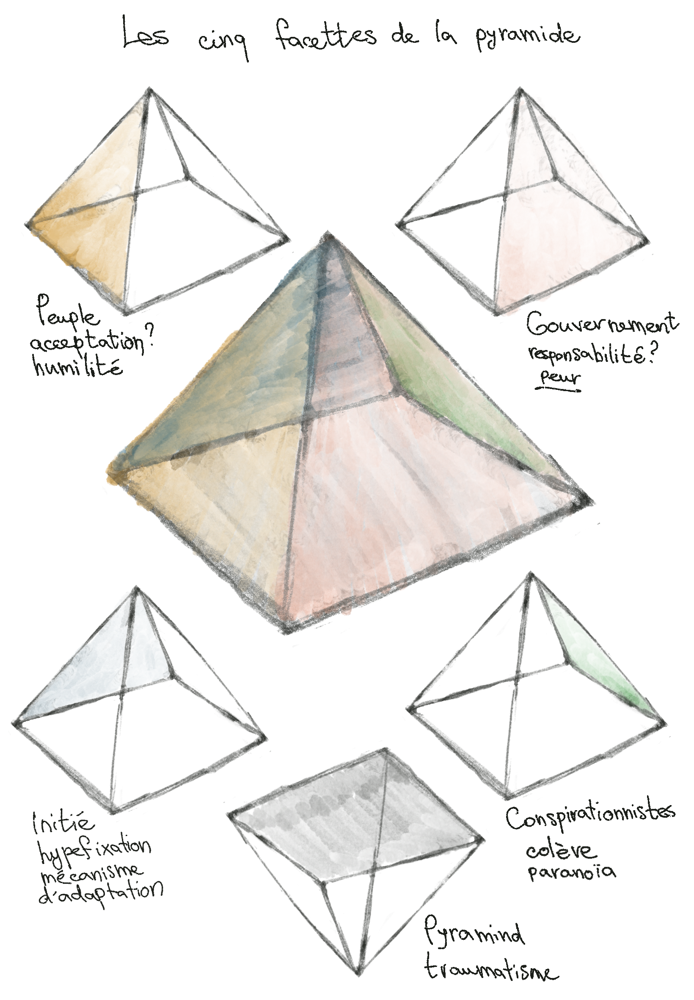

# **Pyramind**

## *Nom*

Le mot « *Pyramind* » a été créé en combinant les mots anglais *pyramid* et *mind*. Il fait ainsi le lien entre sa structure pyramidale, sa nature métaphysique et les thématiques psychologiques du projet.

En même temps, ce mot contient la partie « \-ramind », qui me fait penser au mot *remind* — le fait de rappeler quelque chose à quelqu'un, de faire en sorte qu'une personne se souvienne de quelqu'un ou de quelque chose.

Le mot lui-même ressemble également à *pyromania* (pyromanie) : un trouble du contrôle des impulsions dans lequel les individus éprouvent des difficultés répétées à résister à l'envie de provoquer volontairement des incendies. Une personne atteinte de pyromanie déclenche délibérément des incendies à plusieurs reprises. Avant de passer à l'acte, elle ressent généralement une tension et une accumulation émotionnelle. L'accumulation de stress dans la vie quotidienne est l'une des causes courantes de la pyromanie.

## **Introduction de l'ARG**

En 2006, à Dnipro, en Ukraine, une gigantesque pyramide inversée est apparue soudainement dans le ciel, sans aucune explication. Son apparition a provoqué une panique massive, une psychose religieuse, des suicides collectifs, une propagation de théories du complot ainsi qu'une vague de terreur autour de la prétendue « fin du monde imminente ».

Cependant, cet objet, qui sera plus tard baptisé *Pyramind*, ne faisait absolument rien. Il restait immobile dans le ciel, se contentant d'émettre de temps à autre d'étranges sons. Certaines personnes se plaignaient de maux de tête qu'elles lui attribuaient, tandis que d'autres affirmaient qu'il influençait leurs pensées et s'immisçait dans leurs rêves. Pourtant, aucune de ces affirmations n'a jamais été prouvée, et les recherches menées sur ces phénomènes n'ont révélé aucune anomalie particulière.

Le gouvernement, de son côté, a également refusé d'intervenir. Personne ne savait ce qu'était cet objet, ni quels dégâts il pourrait causer aux habitants de la ville, au pays ou même au monde entier. C'est cette même peur qui a conduit à interdire, dans les faits, toute recherche approfondie. Après tout, comment étudier un objet venu d'ailleurs sans risquer de l'activer accidentellement ? Et si c'était une bombe ? Un vaisseau spatial ? Ou encore un gigantesque transmetteur de signaux ?

On ne répare pas ce qui n'est pas cassé, et on ne touche pas à ce qu'on ne sait pas réparer.

Comme tout le reste dans notre monde moderne au rythme effréné, l'intérêt pour l'existence paradoxale de Pyramind s'est progressivement estompé. Vingt ans plus tard, il n'est plus qu'une huitième merveille du monde : une attraction touristique populaire, où les visiteurs viennent simplement l'admirer et prendre des photos à ses côtés.

## **Les cinq faces de la pyramide \- les cinq perspectives**

Nous découvrons la réalité de cet univers et les différentes positions adoptées à l'égard de Pyramind à travers cinq perspectives distinctes, présentées au moyen de différents types de médias.

* **Gouvernement** — *State Service of the Supervision of Anomalous Objects of Ukraine* (S3AOU)  
  *Служба Нагляду за Аномальними Об'єктами України (СНАОУ).*  
  Service national ukrainien de surveillance des objets anormaux.  
* **Complotistes** — *International Pyramind Conspiracy Solvers Society* (IPCS2).  
  Société internationale des résolveurs de complots liés aux pyramides  
* **Insider** — Employé de *National Institute for Extraterrestrial and Anomalous Research of Ukraine* (NIEARU)  
  *Національний Інститут Досліджень Позаземних та Аномальних Об'єктів України (НІДПАОУ).*  
  l’Institut national ukrainien de recherche sur les objets extraterrestres et anormaux.  
* **Population** — Des gens ordinaires qui mènent leur vie quotidienne dans un monde qui ne l'est pas.  
* **Pyramind** — ???

#### **Gouvernement**

Les institutions gouvernementales transmettent la position officielle de l'État : tout va bien et la situation est sous contrôle. Cette communication se fait par le biais de canaux officiels : chaînes d'information, site web gouvernemental, etc.

Elles sont guidées par la peur et par le poids de leur responsabilité envers des millions, voire des milliards de vies. C'est pourquoi elles refusent de prendre la moindre mesure, tout en interdisant à quiconque d'intervenir. Cette inaction permet à Pyramind de rester une énigme.

#### **Complotistes**

Les complotistes publient activement sur les réseaux sociaux — TikTok, forums et leur propre site web, conçu comme une sorte de « communauté secrète ». Ils échangent en groupe leurs dernières théories et découvertes.

Bien qu'ils affirment lutter pour la vérité, une cause à laquelle ils croient sincèrement, le sentiment d'appartenance à une communauté et les échanges entre ses membres comptent davantage pour eux que la recherche d'une véritable réponse.

#### **Initié** 

Insider est un employé actif du NIEARU qui consacre une grande partie de sa vie à l'étude de Pyramind, après en avoir été personnellement affecté.

Afin de conserver son poste et de maintenir autant que possible son accès à l'objet, il cherche à préserver son anonymat au maximum.

Les réponses sont la seule chose qui l'intéresse réellement. Les personnes qu'il recrute au sein de sa « team » (nous) ne sont, à ses yeux, que des cobayes de laboratoire, destinés à mettre ses théories à l'épreuve.

#### **Population**

Des gens ordinaires qui mènent simplement leur vie. Ils sont généralement passifs et prennent très rarement des initiatives.

Certains partagent des fragments de leur quotidien sur Internet, ce qui nous permet d'observer Pyramind sous un angle beaucoup plus banal et passif : celui de personnes qui ont appris à vivre avec sa présence.

## **Signification “profonde” — ce que je veux exprimer**

Pyramind est avant tout une représentation du traumatisme.

Il apparaît « de nulle part » (cela ne veut pas dire que les traumatismes n'ont pas de contexte, mais plutôt que, lorsqu'ils surviennent, la première pensée de la plupart des gens est : « Comment est-ce arrivé ? Pourquoi ? Pourquoi moi ? »).

Personnellement, j'y vois une représentation de la guerre, mais chacun peut l'interpréter à sa manière, en fonction de sa propre situation personnelle.

Les personnages de l'histoire ont eux-mêmes des traumatismes liés à Pyramind, et chaque faction représente une réaction différente face à ce traumatisme.

**Government**

Il est question de peur : quelque chose d'horrible vous est arrivé et vous avez la responsabilité de protéger votre population. Vous ne savez pas quoi faire et chacune de vos actions risque d'aggraver la situation. La peur de voir une compréhension de la réalité, déjà ébranlée, s'effondrer davantage est donc votre principal moteur.

**People**

Il est question d'engourdissement : les gens n'ont pas l'impression de pouvoir faire quoi que ce soit face à tout cela, et leur mécanisme d'autoprotection le plus simple consiste à se protéger de ces horreurs qui bouleversent leur réalité : ignorer, ne pas y penser, passer à autre chose, que l'on soit prêt ou non.

**Complotistes** 

Ils sont en colère contre le fait qu'on les oblige à « sourire et faire coucou », à passer à autre chose comme si rien ne s'était passé, alors que le problème existe toujours (la pyramide est toujours dans le ciel). Pour eux, c'est comme si l'on disait aux autres qu'ils devaient devenir de meilleures personnes et pardonner, alors que personne ne s'est encore excusé.

Colère et paranoïa, sentiment de trahison.

**Initié** 

Le dernier personnage est un homme de l'intérieur, un scientifique qui, après avoir vécu un contact extrêmement rapproché avec Pyramind, devient obsédé par son traumatisme et consacre toutes ses forces et tout son temps à essayer de le comprendre, en créant des théories et des hypothèses telles que la théorie de *unremembering vs forgetting*.

L'idée est que si l'on oublie son traumatisme ou que l'on modifie sa perception de l'événement traumatique, cela modifiera l'événement lui-même dans le temps et dans l'espace.

Une sorte de mécanisme de défense psychologique hardcore.

Je pense faire d'Insider une sorte d'opposé des complotistes, ainsi que créer une évolution inverse des sentiments des joueurs à son égard, tout comme mes propres sentiments ont évolué à l'inverse.

Au début, la seule chose qui nous intéresse, ce sont les réponses. Nous avançons à travers les énigmes, découvrons ces informations confidentielles et commençons immédiatement à éprouver de l'empathie pour Insider et pour son conflit avec l'administration, tout en méprisant les complotistes, leur site public « secret » complètement ridicule, leurs discussions absurdes, leurs disputes pour rien et cette sorte de fandom qu'ils créent au lieu de mener de véritables enquêtes, comme ils sont censés le faire.

Mais plus nous en apprenons sur ces personnages, plus nous observons leurs actions et leurs interactions, et plus nous comprenons la véritable nature de Pyramind, plus nous réalisons que ces personnages sont complexes.

Au bout du compte, ils sont tous des victimes et ce qu'ils recherchent, c'est le salut.

Les complotistes cherchent une communauté et trouvent du réconfort les uns auprès des autres face à ce traumatisme.

Insider rejette l'humanité et croit qu'il ne peut trouver la paix que dans la vérité, quel qu'en soit le prix ou le « besoin » de blesser les personnes qui l'entourent, ce qui finit par le conduire sur un chemin autodestructeur.

**// Pour plus tard :** ajouter un point narratif où l'IPCS2 coupe les ponts avec Insider après qu'une de ses expériences a psychologiquement traumatisé l'un de ses membres.

## **Scénario**

Tout devrait commencer sur TikTok, avec une vidéo publiée par l'IPCS2 à l'occasion de l'anniversaire des 20 ans de l'Apparition — le jour où Pyramind est apparu dans le ciel, au-dessus du fleuve Dnipro.

Dans cette vidéo, les membres de la société vont critiquer vivement une nouvelle publication sur le site officiel du S3AOU et inciter les spectateurs à venir plutôt consulter leur propre site, où ils pourront découvrir la VRAIE VÉRITÉ sur Pyramind.

À partir de là, deux possibilités s'offrent à nous → suivre un lien dans la description qui nous redirige vers leur site web, ou → rechercher nous-mêmes leur site officiel.

Sur le site de l'IPCS2, on découvre quelque chose qui ressemble à GeoCities. Il y a une page d'accueil principale avec une description et des règles\*, ainsi que plusieurs pages créées par les membres de la communauté et présentant leurs théories. On y trouve également un chat et un onglet d'inscription.

Règles :

\- Respectez les autres.

\- Les discours haineux sont interdits.

\- Votre page doit respecter le code vestimentaire.

\- Pour interagir avec les autres dans le chat ou commenter leurs publications, vous devez être inscrit. Cependant, à la suite de la dernière attaque informatique, la fonction d'inscription est actuellement indisponible. Les administrateurs demandent donc aux nouveaux membres de la communauté de faire preuve de patience. 

Si vous cliquez sur l'onglet « Inscription », vous serez redirigé vers un écran affichant le message : « Temporairement fermé :( ».

Référence visuelle : Hypnospace Outlaw

