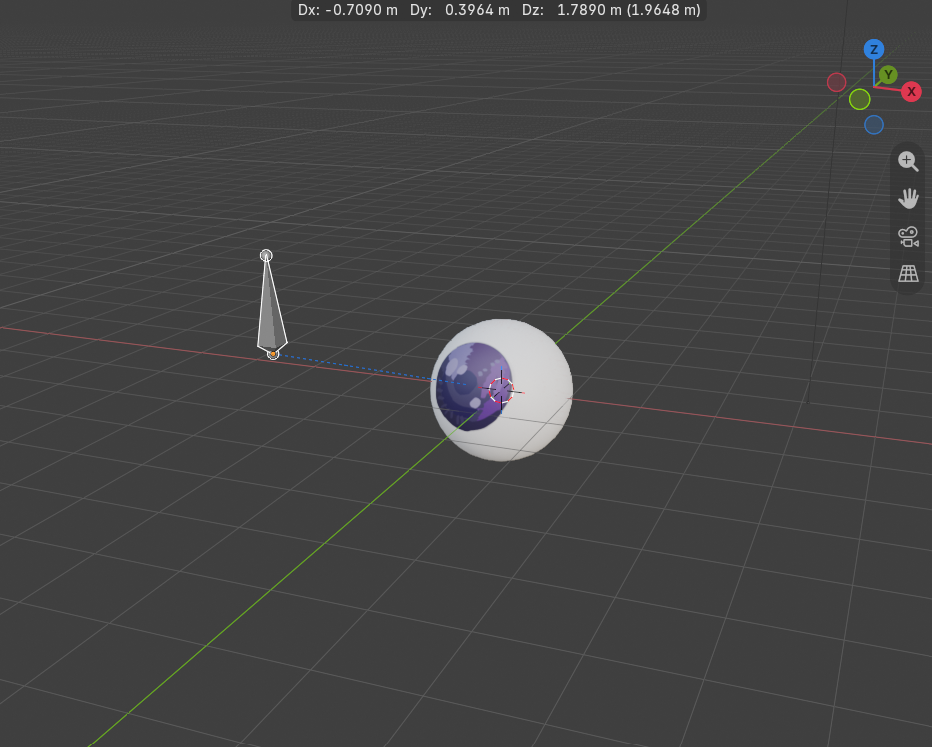
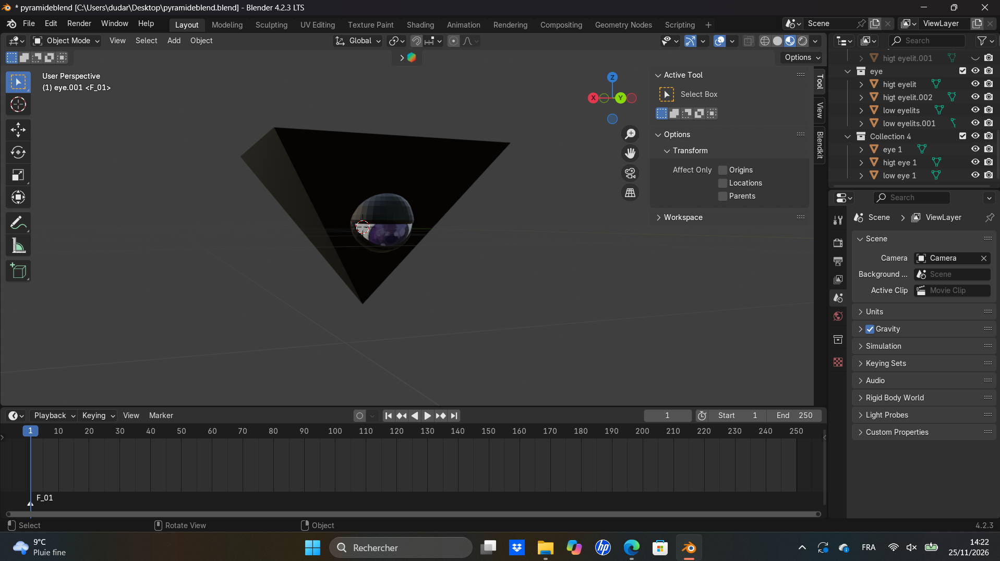
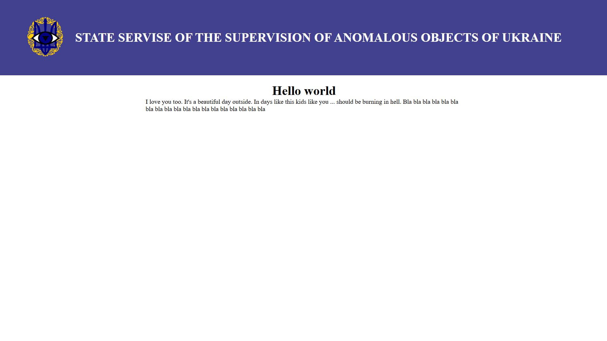
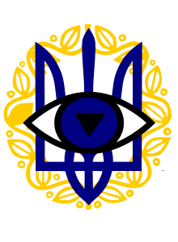

# Fiche Pédagogique

## Informations étudiant·e

- **Nom :** DUDARENKO

- **Prénom :** Dana

## Profil et connaissances

### Présentation personnelle

// Décrivez en quelques phrases vos objectifs à court terme et à long terme, si vous en avez :

Poursuivre un master dans le domaine du DAD, soit dans une école d’art comme l’ESAD d’Orléans ou l’ESAAIX, soit dans le domaine du game design ou du design graphique à l’ENJMIN. Ensuite, j’aimerais trouver un emploi stable et construire ma carrière dans l’industrie du jeu vidéo ou dans un autre secteur créatif lié au design des médias. Selon la durée et l’issue de la guerre russo-ukrainienne, je pourrais décider de construire ma vie ici, de partir vivre en Allemagne ou de retourner dans mon pays.

### Compétences

**CODE CRÉATIF** 12 

>Plus ou moins à l’aise avec HTML et CSS, avec un niveau intermédiaire en JavaScript. J’ai également de l’expérience avec Godot et C#, mais j’ai principalement utilisé l’IA pour m’aider dans ces domaines, donc je ne suis pas certaine de ce que je serais capable de faire sans elle. En revanche, je sais que j’ai de bonnes capacités de raisonnement logique. J’ai simplement besoin de prendre le temps d’apprendre sérieusement les langages de programmation lorsque j’en aurai l’occasion, comme avec cette formation.

**GIT ET VERSIONING** 15 

>Je ne suis pas certaine, mais je ne pense pas avoir de difficultés à comprendre le fonctionnement de Git.

**INTERACTIVITÉ ET RENDU TEMPS RÉEL** 15 

>J’ai déjà réalisé plusieurs projets interactifs, principalement des jeux vidéo. En revanche, je ne suis pas certaine de comprendre ce que signifie « en temps réel » dans ce contexte.

**INSTALLATION ET MISE EN ESPACE** 10 

>Je ne sais pas vraiment comment répondre à cette question. Mes présentations sont généralement assez simples et ont surtout un objectif précis : montrer ce que j’ai réalisé. La mise en page est habituellement liée au processus de création. Je ne sais pas encore comment présenter ce projet de manière intéressante sans avoir recours à une dizaine d’écrans différents.

**PRÉSENTATION ET ARGUMENTATION** 12 

>Si je suis bien préparée, je pense que je m’en sors plutôt bien, ou du moins aussi bien que possible. Je n’aime pas lire un texte pendant une présentation, car cela casse un peu le naturel et le rythme. Mais le français n’étant pas ma langue maternelle, il m’arrive parfois d’oublier certains mots, d’utiliser des anglicismes ou des formulations beaucoup plus simples que je ne le voudrais. Il m’arrive aussi de perdre le fil de mon raisonnement en parlant, mais c’est plutôt un problème personnel. Le fait de devoir m’exprimer en français et le stress ne font qu’aggraver les choses.

## Projets

#### Sujet du projet

- **Titre du projet** : **Pyramind**
- **Description du projet (environ 150 mots) :**

**Pyramind** est un projet d'ARG (*Alternate Reality Game*) qui explore les liens entre la mémoire, le temps, le traumatisme et la perception de la réalité.

Pour cet ARG, je souhaite utiliser différents types de médias : sites web, bots de messagerie électronique, jeux vidéo, vidéos, fichiers audio, réseaux sociaux, et peut-être des contrôleurs alternatifs (*alternative controllers*) ainsi que des chasses au trésor géolocalisées (*geohunts*), si je trouve un moyen de les mettre en place.

Tous ces éléments seront reliés entre eux par des énigmes cryptiques et des codes cachés. Le projet demandera aux joueurs de s'impliquer, de faire preuve de patience et peut-être même d'une certaine obsession.

#### Thématiques de recherche

- **Thématiques que vous souhaitez explorer :**
- **Pourquoi cette thématique vous intéresse-t-elle ? (environ 100 mots) :** add later

#### Outils et techniques

- **Outils que vous comptez utiliser (logiciels, langages de programmation, etc.) :** add later
- **Techniques spécifiques que vous souhaitez maîtriser ou expérimenter :**

#### Références artistiques

- **Argumentaire expliquant la pertinence de votre projet (environ 150 mots) :** add later
- **Références artistiques qui inspirent votre travail (livres, artistes, œuvres, etc.) :**

## Actions

### Présentation orale d'un sujet artistique ou design (documentation de recherche)

// Sujet choisi, membres du groupe, date de passage et lien vers votre présentation :

### Accrochage de rendu

// Décrivez ce que vous allez présenter et comment vous comptez le mettre en espace :

### Contribution au logiciel

// Décrivez votre participation à la conception de l'outil commun et votre réflexion sur le sens du logiciel :

## Planification

### Planning de travail

- Établissez un planning des étapes clés de votre projet :
  - **Étape 1 :** *25/11 - 27/11* Préparation
  - **Étape 2 :** *30/11 - 07/12* Travail sur le code et les vidéos
  - **Étape 3 :** *08/12 - 11/12* Dernières retouches et contrôle / rendu

  ##

  - **25/11** – Terminer le scénario, créer davantage de concept arts. Créer les éléments visuels nécessaires pour les sites (GIFs, images métriques, maquettes), rassembler des références.
  - **27/11** – Créer les éléments visuels nécessaires pour les sites (GIFs, images métriques, maquettes), commencer à créer les sites.
  - **30/11** – Créer les sites.
  - **01/12** – Créer le bot mail.
  - **02/12** – Créer le jeu.
  - **04/12** – Créer les éléments visuels pour le fond de la vidéo.
  - **07/12** – Créer les vidéos.
  - **08/12** – ?
  - **09/12** – Contrôle.
  - **11/12** – Rendu.

> Ce travail fera finalement partie de mon diplôme et je ne peux pas réalistement réaliser tout ce que j'ai prévu. Je dois donc m'arrêter à un certain point pour ce cours, afin de pouvoir réellement terminer tout cela dans les délais et éviter que ma présentation soit désorganisée.
Je pense qu'une ou deux vidéos, quatre sites, un jeu et un bot mail pourraient suffire. Cela permettrait également d'avoir une présentation visuellement intéressante.

## Commentaires et questions

// Avez-vous des questions ou des préoccupations à propos du cours ou de vos projets ? :

## Journal de bord

Ajoutez une entrée à chaque jour de cours, la plus récente en haut.

### 27/11/2026

- **Ce que j'ai fait :**

Aujourd'hui, j'ai travaillé sur les concept arts et la maquette du site des théoriciens du complot. Cela va m'aider, pendant la création du site lui-même, à savoir exactement quels textes je dois écrire, quels boutons je dois placer et où, quelles couleurs utiliser (approximativement), ainsi que quelles images, illustrations et animations je dois préparer.

Je regrette d'avoir commencé à travailler sur le site officiel hier, car aujourd'hui, je me suis rendu compte que beaucoup trop de choses n'avaient pas été réfléchies ni planifiées. Je vais probablement créer une maquette, puis refaire le site.

J'ai également continué à travailler sur l'animation 3D. J'ai trouvé un bon tutoriel pour animer des yeux.

- **Problèmes rencontrés :**

Je ne me sens pas à l'aise dans cette salle. Il y a quelque chose qui ne va pas avec la lumière, la tension dans l'air froid et le fait qu'il y ait autant de personnes ici. Je ne peux donc pas me cogner la tête contre le mur quand quelque chose ne fonctionne pas (c'est une partie importante du processus), sans parler du fait que quelqu'un ouvre et ferme constamment cette put♥in de porte. Je n'arrive pas à me concentrer ici et je préfère travailler chez moi. J'ai vraiment l'impression de perdre trop de temps ici.

Je n'ai pas rencontré de problèmes techniques, à part ce qui s'est passé avec le site officiel.

- **Prochaine étape :**

Pour le prochain cours, j'espère pouvoir passer à la réalisation et, dans l'idéal, terminer au moins deux des quatre sites. Je dois encore comprendre comment créer le bot mail, faire les vidéos et développer le jeu.

- **Captures / liens :**

### 25/11/2026

- **Ce que j'ai fait :**

Aujourd’hui, j’ai mis à jour mon scénario et j’ai commencé à travailler sur une animation 3D que je voudrais utiliser comme logo pour l’un des sites. J’ai également commencé à créer l’un des sites. Il s’agira d’un site gouvernemental officiel, inspiré des sites officiels des gouvernements ukrainien et français.

J’ai créé un logo officiel pour ce site, en m’inspirant du style graphique typique des logos institutionnels ukrainiens.

J’ai aussi demandé à un ami s’il aimerait participer à mon ARG. Je vais créer un site/forum pour les membres d’une communauté conspirationniste (IPCSS), et j’aurai besoin d’utilisateurs actifs avec des personnalités bien définies. Je me suis dit que le plus simple serait de demander à des amis que je connais déjà et auxquels j’ai facilement accès, de m’inspirer de leur personnalité et de leur demander conseil pour créer des personnages intéressants dans cet univers alternatif. En gros, ce seront des versions alternatives d’eux-mêmes, mais il faut imaginer que la plupart d’entre eux ne sont pas forcément français ou ukrainiens.

- **Problèmes rencontrés :**

J’ai un problème avec Blender. Soit le logiciel bugue complètement, soit c’est moi qui suis stupide. J’ai téléchargé la dernière version de Blender et maintenant tout fonctionne correctement, mais je devrai peut-être regarder quelques tutoriels sur YouTube pour apprendre à animer des yeux. Si possible, je voudrais éviter de créer un œil hyperréaliste avec 10 000 000 de polygones super mega HD qui ferait prendre feu à mon ordi.

Autre chose : le codage me prend plus de temps parce que j’ai décidé de ne pas utiliser l’IA pour tout faire à ma place. J’essaie de coder moi-même, de chercher des exemples de code sur Internet, de demander des conseils ou des explications à l’IA si nécessaire, et de noter tout le processus dans mon carnet. C’est beaucoup plus long, mais j’apprends vraiment des choses et je comprends ce que je fais. Comme ça, quand quelque chose ne fonctionne plus, je sais quoi et pourquoi.

- **Prochaine étape :**

Il me reste à écrire et à ajouter du texte ainsi qu’une autre image sur le site. Je dois aussi terminer et faire le rendu de l’animation, puis la convertir en GIF. Je vais peut-être encore apporter quelques modifications à mon logo pour S3AOU.

Je dois aussi commencer à créer les autres sites.

- **Captures / liens :**
  - Dossier 
  [Base theoretique/Scenario](https://github.com/Dana-Dudarenko/DAD-NNN-Dana/blob/main/Base%20theoretique%20-%20Scenario.md)

### 24/11/2026

- **Ce que j'ai fait :**

J'ai continué à travailler sur la partie théorique de mon ARG : le scénario, l'histoire et sa signification. J'ai essayé d'organiser les idées que j'avais précédemment notées dans mon document Google Docs et de les développer afin de mieux clarifier ma vision du résultat final.
J'ai créé un concept art de Pyramind à partir de photos réelles de Dnipro. J'ai également dessiné un schéma des cinq faces de la pyramide, qui représentent cinq perspectives différentes nous permettant de mieux comprendre cet univers.

- **Problèmes rencontrés :** Aucun problème particulier
- **Prochaine étape :** Terminer le scénario, créer davantage de concept arts. Créer les éléments visuels nécessaires pour les sites (GIFs, images métriques, maquettes), rassembler des références.
- **Captures / liens :** 
  - Dossier 
  [Base theoretique/Scenario](https://github.com/Dana-Dudarenko/DAD-NNN-Dana/blob/main/Base%20theoretique%20-%20Scenario.md)

### JJ/MM/AAAA

- **Ce que j'ai fait :**
- **Problèmes rencontrés :**
- **Prochaine étape :**
- **Captures / liens :**
