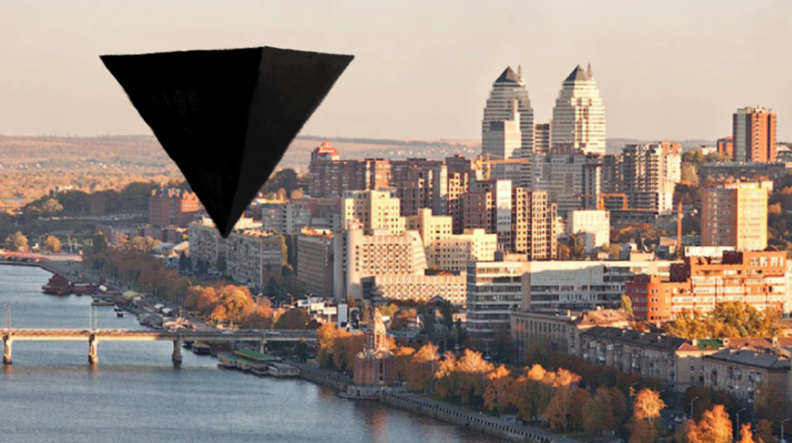
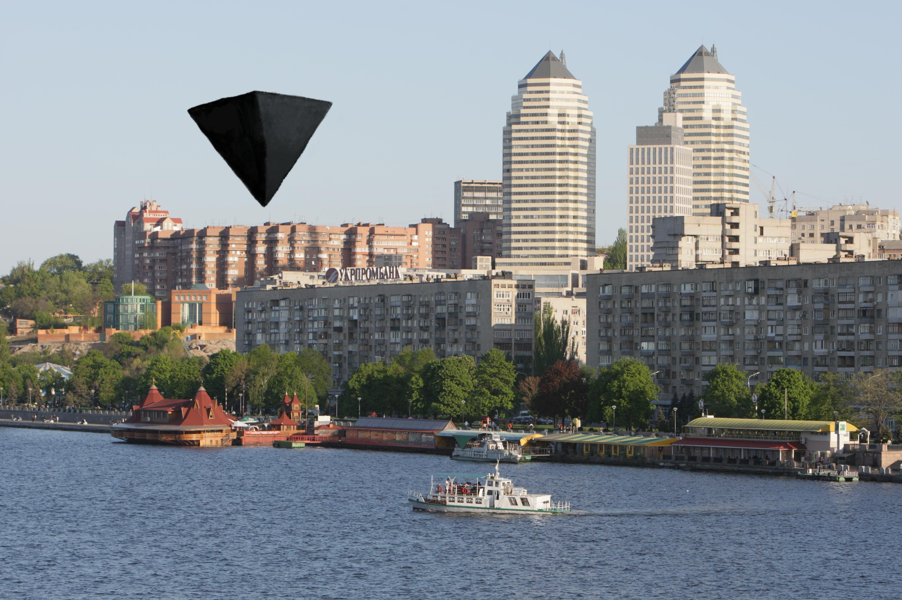

# Fiche Pédagogique

## Informations étudiant·e

- **Nom :** Dudarenko

- **Prénom :** Dana

## Profil et connaissances

### Présentation personnelle

// Décrivez en quelques phrases vos objectifs à court terme et à long terme, si vous en avez :

Poursuivre un master dans le domaine du DAD, soit dans une école d’art comme l’ESAD d’Orléans ou l’ESAAIX, soit dans le domaine du game design ou du design graphique à l’ENJMIN. Ensuite, j’aimerais trouver un emploi stable et construire ma carrière dans l’industrie du jeu vidéo ou dans un autre secteur créatif lié au design des médias. Selon la durée et l’issue de la guerre russo-ukrainienne, je pourrais décider de construire ma vie ici, de partir vivre en Allemagne ou de retourner dans mon pays.

### Compétences

**CODE CRÉATIF** 12 (plus ou moins à l’aise avec HTML et CSS, avec un niveau intermédiaire en JavaScript. J’ai également de l’expérience avec Godot et C#, mais j’ai principalement utilisé l’IA pour m’aider dans ces domaines, donc je ne suis pas certaine de ce que je serais capable de faire sans elle. En revanche, je sais que j’ai de bonnes capacités de raisonnement logique. J’ai simplement besoin de prendre le temps d’apprendre sérieusement les langages de programmation lorsque j’en aurai l’occasion, comme avec cette formation.)

**GIT ET VERSIONING** 15 (Je ne suis pas certaine, mais je ne pense pas avoir de difficultés à comprendre le fonctionnement de Git.)

**INTERACTIVITÉ ET RENDU TEMPS RÉEL** 15 (J’ai déjà réalisé plusieurs projets interactifs, principalement des jeux vidéo. En revanche, je ne suis pas certaine de comprendre ce que signifie « en temps réel » dans ce contexte.)

**INSTALLATION ET MISE EN ESPACE** 10 (Je ne sais pas vraiment comment répondre à cette question. Mes présentations sont généralement assez simples et ont surtout un objectif précis : montrer ce que j’ai réalisé. La mise en page est habituellement liée au processus de création. Je ne sais pas encore comment présenter ce projet de manière intéressante sans avoir recours à une dizaine d’écrans différents.)

**PRÉSENTATION ET ARGUMENTATION** 12 (Si je suis bien préparée, je pense que je m’en sors plutôt bien, ou du moins aussi bien que possible. Je n’aime pas lire un texte pendant une présentation, car cela casse un peu le naturel et le rythme. Mais le français n’étant pas ma langue maternelle, il m’arrive parfois d’oublier certains mots, d’utiliser des anglicismes ou des formulations beaucoup plus simples que je ne le voudrais. Il m’arrive aussi de perdre le fil de mon raisonnement en parlant, mais c’est plutôt un problème personnel. Le fait de devoir m’exprimer en français et le stress ne font qu’aggraver les choses.)

## Projets

#### Sujet du projet

- **Titre du projet : **Pyramind**
- **Description du projet (environ 150 mots) :**

**Pyramind** est un projet d'ARG (*Alternate Reality Game*) qui explore les liens entre la mémoire, le temps, le traumatisme et la perception de la réalité.

Pour cet ARG, je souhaite utiliser différents types de médias : sites web, bots de messagerie électronique, jeux vidéo, vidéos, fichiers audio, réseaux sociaux, et peut-être des contrôleurs alternatifs (*alternative controllers*) ainsi que des chasses au trésor géolocalisées (*geohunts*), si je trouve un moyen de les mettre en place.

Tous ces éléments seront reliés entre eux par des énigmes cryptiques et des codes cachés. Le projet demandera aux joueurs de s'impliquer, de faire preuve de patience et peut-être même d'une certaine obsession.

#### Thématiques de recherche

- **Thématiques que vous souhaitez explorer :**
- **Pourquoi cette thématique vous intéresse-t-elle ? (environ 100 mots) :** add later

#### Outils et techniques

- **Outils que vous comptez utiliser (logiciels, langages de programmation, etc.) :** add later
- **Techniques spécifiques que vous souhaitez maîtriser ou expérimenter :**

#### Références artistiques

- **Argumentaire expliquant la pertinence de votre projet (environ 150 mots) :** add later
- **Références artistiques qui inspirent votre travail (livres, artistes, œuvres, etc.) :**

## Actions

### Présentation orale d'un sujet artistique ou design (documentation de recherche)

// Sujet choisi, membres du groupe, date de passage et lien vers votre présentation :

### Accrochage de rendu

// Décrivez ce que vous allez présenter et comment vous comptez le mettre en espace :

### Contribution au logiciel

// Décrivez votre participation à la conception de l'outil commun et votre réflexion sur le sens du logiciel :

## Planification

### Planning de travail

- Établissez un planning des étapes clés de votre projet :
  - **Étape 1 :** date et description
  - **Étape 2 :** date et description
  - **Étape 3 :** date et description

## Commentaires et questions

// Avez-vous des questions ou des préoccupations à propos du cours ou de vos projets ? :

## Journal de bord

Ajoutez une entrée à chaque jour de cours, la plus récente en haut.

### 24/11/2026

- **Ce que j'ai fait :**

 J'ai continué à travailler sur la partie théorique de mon ARG : le scénario, l'histoire et sa signification. J'ai essayé d'organiser les idées que j'avais précédemment notées dans mon document Google Docs et de les développer afin de mieux clarifier ma vision du résultat final.
J'ai créé un concept art de Pyramind à partir de photos réelles de Dnipro. J'ai également dessiné un schéma des cinq faces de la pyramide, qui représentent cinq perspectives différentes nous permettant de mieux comprendre cet univers.

- **Problèmes rencontrés :**
- **Prochaine étape :**
- **Captures / liens :** 
Dossier **Base theoretique/Scenario**
https://github.com/Dana-Dudarenko/DAD-NNN-Dana/blob/main/Base%20theoretique%20-%20Scenario.md

## Journal de bord

Ajoutez une entrée à chaque jour de cours, la plus récente en haut.

### JJ/MM/AAAA

- **Ce que j'ai fait :**
- **Problèmes rencontrés :**
- **Prochaine étape :**
- **Captures / liens :**
